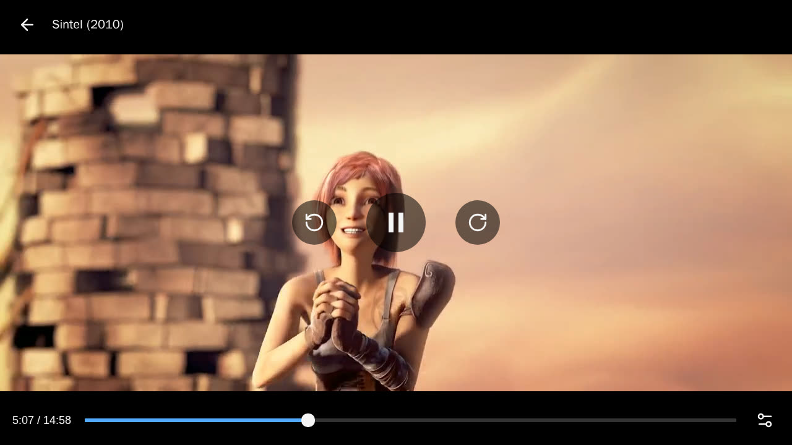

<div align="center">

# BackseatFin

**車が走行中でも、車内のブラウザで Jellyfin・Emby のライブラリと YouTube を視聴できます。**

[](https://github.com/jiaton/backseatfin/actions/workflows/ci.yml)
[](https://github.com/jiaton/backseatfin/releases)
[](LICENSE)
[](https://emby.media)
[](docs/jellyfin.md)
[](https://github.com/jiaton?tab=packages&repo_name=backseatfin)

[English](README.md) · [简体中文](README.zh-CN.md) · 日本語 · [Español](README.es.md) · [Deutsch](README.de.md)

このドキュメントは英語版を翻訳したものです。内容は英語版が正本です。

</div>



<sub>スクリーンショット：[Sintel](https://durian.blender.org/) © Blender Foundation、[CC BY 3.0](https://creativecommons.org/licenses/by/3.0/)。</sub>

Tesla などの車載ブラウザは走行中に `<video>` を停止しますが、`<canvas>` の描画は継続します。BackseatFin はメディアサーバー自身の Web アプリに canvas プレーヤーを追加します。車内で Jellyfin または Emby を開き、再生ボタンを押すだけで再生されます。

- **追加のサーバーは不要。** Jellyfin はプラグイン、Emby は小さな nginx コンテナ 1 つだけ。トランスコードはメディアサーバー自身が行い、プレーヤーはあなた自身のログインを使います。
- **自分のライブラリ、自分のサーバー。** シーク、音声トラック、字幕（PGS を含む）、再生位置の再開、「視聴済み」のステータスはすべてサーバーと同期します。
- **車への負荷が小さい。** WebCodecs 経由で車のハードウェア H.264 デコーダーを使用し、対応していない場合は JSMpeg にフォールバックします。ストリームは画面サイズに合わせて調整され、通信の途切れも乗り越えます。
- **HDR と Dolby Vision** はトーンマッピングされます（Jellyfin の場合：Jellyfin 自身が処理／Emby の場合：オプションの BackseatFin サーバーが Intel GPU または CPU 上で処理）。
- **セルフホストの YouTube。** 車向けの画面で検索し、チャンネルをフォローし、止めたところから続きを見られます。動画は自分のサーバーを通って YouTube のエンコードのまま届き（再エンコードなし）、Google アカウントは不要で、視聴履歴は手元に残ります。スマホで YouTube の再生リストに動画を追加すると、車のホーム画面に表示されます。

> [!WARNING]
> 同乗者向けの機能です。運転者は必ず前方を注視してください。運転中に動画を視聴することは危険であり、多くの地域で違法です。

## クイックスタート

**Jellyfin**（12.0 以降）：Dashboard → Plugins → Repositories でプラグインリポジトリ `https://jiaton.github.io/backseatfin/jellyfin/manifest.json` を追加し、**BackseatFin** をインストールして再起動し、どのブラウザで車載プレーヤーを使うかを選びます。ガイド：[docs/jellyfin.md](docs/jellyfin.md)。

**YouTube と Emby**：Docker で BackseatFin を動かします。

```sh
git clone https://github.com/jiaton/backseatfin.git && cd backseatfin
cp .env.example .env   # API_KEY（YouTube）と EMBY_URL（Emby）を必要に応じて設定
docker compose up -d
```

その後、HTTPS の背後に置き（[例](docs/reverse-proxy.md)）、車内で開いてください。ガイド：[docs/install.md](docs/install.md)。

## 動作の仕組み

```
Jellyfin:  car browser ──► Jellyfin web app + plugin script
                              └─► /BackseatFin/play ◄── Jellyfin's HLS transcode (H.264)

Emby:      car browser ──► car host (nginx) ──► Emby web app + inject.js
                              └─► /car/play ◄── Emby's HLS transcode (H.264)
                                            ◄── optional BackseatFin server (HDR)

YouTube:   car browser ──► BackseatFin app (search, channels, history)
                              └─► /play ◄── BackseatFin server ◄── YouTube's H.264, passed through
```

再生ボタンを押すと、プレーヤーがサーバーのページの上に開きます。車のハードウェアデコーダー（WebCodecs）で H.264 ストリームをデコードし、canvas に描画します。コントリビューター向けの詳細は [AGENTS.md](AGENTS.md) と [docs/player.md](docs/player.md) にあります。

## ロードマップ

- [x] Emby（car host 経由、リバースプロキシによる注入、Emby 自身の HLS を再生）
- [x] Jellyfin プラグイン、Jellyfin 自身の HLS を再生（追加サーバー不要）
- [x] HDR / Dolby Vision トーンマッピング（Intel GPU、CPU）
- [x] 車で YouTube：検索、チャンネルのフォロー、ライブ再生、続きから再生
- [ ] 再生リストの連続再生、字幕、ライブ配信
- [ ] NVIDIA および AMD の GPU

## ライセンス

[MIT](LICENSE)。ただし `jellyfin-plugin/` 内の Jellyfin プラグインは Jellyfin にリンクしているため [GPLv3](jellyfin-plugin/LICENSE) です。[JSMpeg](https://github.com/phoboslab/jsmpeg)（MIT）を内蔵し、[Media Chrome](https://github.com/muxinc/media-chrome)（MIT）を使用しています。
